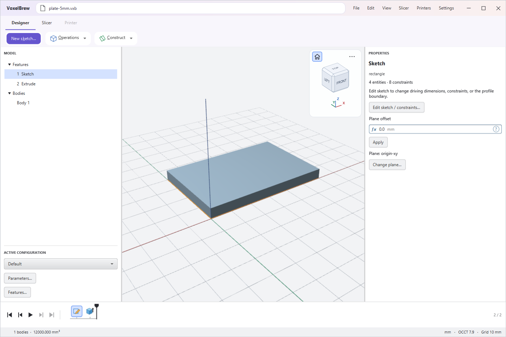
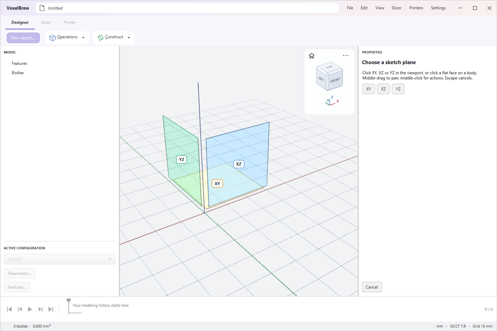
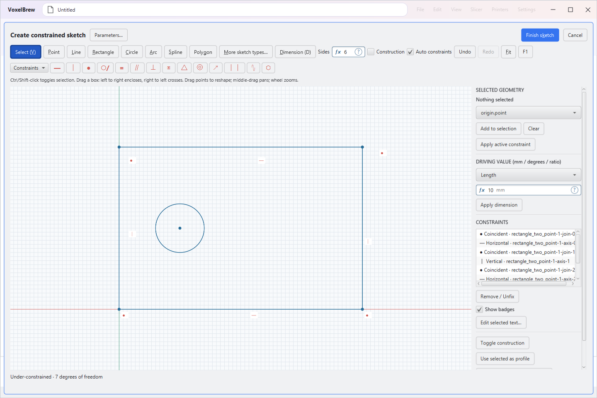
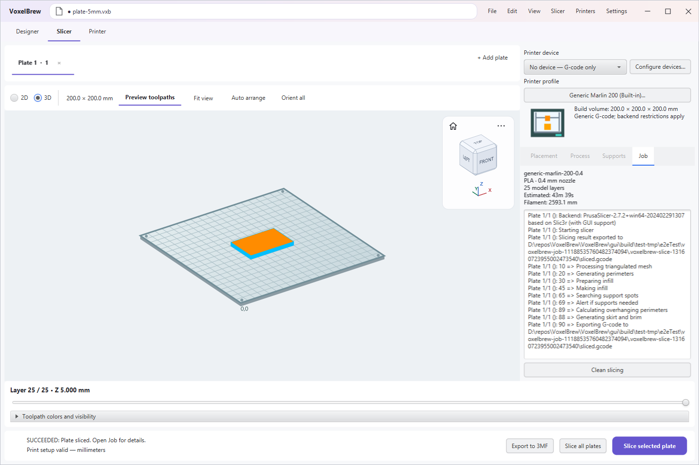
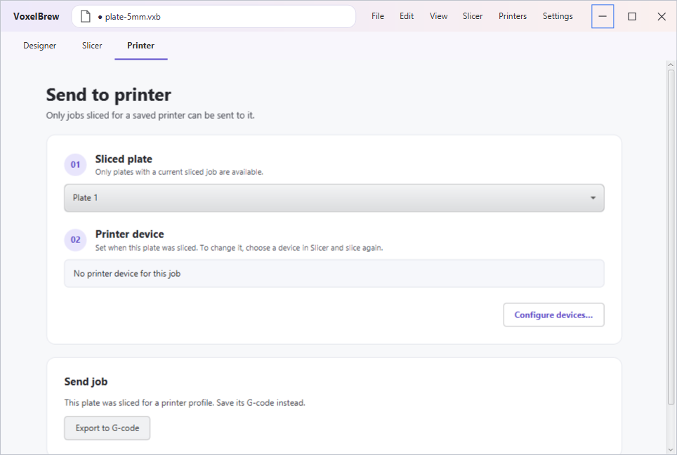

# VoxelBrew CAD

## About

VoxelBrew is an open-source parametric CAD application for 3D designers and makers.
Design parts, refine their dimensions, and prepare them for 3D printing in one
workspace. With a focus on ease of use and flexibility, VoxelBrew aims to make
modeling approachable for beginners while giving experienced designers room to
experiment and extend their workflow.

Create editable models in the desktop application, export them for printing, or
use an integrated slicer backend to turn your designs into printer-ready jobs.
A headless command-line interface also supports modeling and automation.

VoxelBrew supports **Windows, macOS, and Linux**.

[Download the latest release](https://github.com/Voxel-Brew/VoxelBrew/releases/latest).

### Features

- **Parametric modeling:** create dimensioned sketches, extrude solids, and cut
  holes, then adjust dimensions as your design evolves.
- **Editable history:** revisit earlier modeling steps, roll back the timeline,
  and undo or redo changes.
- **Save and reopen:** keep your editable designs in VoxelBrew's `.vxb` format.
- **3D printing workflow:** export STL and 3MF files, configure slicing, and
  inspect toolpaths before printing.
- **Desktop and command line:** work visually in the JavaFX desktop application
  or automate operations through the headless CLI.
- **Extensible workflows:** add importers, exporters, slicer backends, and printer
  integrations through public APIs.

### Screenshots

The Designer, Slicer, and Printer workspaces in the light theme, captured from
the Windows desktop application.

**Designer** — build and edit parametric parts.

Choose a sketch plane, then draw your profile with precise dimensions.

**Slicer** — prepare a plate and preview its generated toolpaths.

**Printer** — select a sliced plate and export its G-code or send it to a
configured printer. This example uses a profile-only job with no device connected.

## Bug reports and contributions

Found a bug? [Open a GitHub issue](https://github.com/Voxel-Brew/VoxelBrew/issues/new)
with the steps to reproduce it, what you expected to happen, and what happened
instead. Include your VoxelBrew version, operating system, and any relevant logs
or screenshots.

Contributions are welcome, from bug fixes and documentation improvements to new
features. Fork the repository and
[submit a pull request](https://github.com/Voxel-Brew/VoxelBrew/pulls).
Please read the [contributor instructions](AGENTS.md) before making changes.

## Development

You can fork VoxelBrew and build on it under the terms of the
[GNU Affero General Public License v3.0](LICENSE). The application uses Java 21,
JavaFX, and Gradle, with Open CASCADE providing the native CAD kernel.

You can also extend VoxelBrew through its public APIs, maintained in independent
repositories under the MIT license:

| API                                                  | Purpose                                            |
| ---------------------------------------------------- | -------------------------------------------------- |
| [Model](https://github.com/Voxel-Brew/api-model)     | Shared model values and validation helpers.        |
| [Import](https://github.com/Voxel-Brew/api-import)   | File import contracts and provider interfaces.     |
| [Export](https://github.com/Voxel-Brew/api-export)   | File export contracts and provider interfaces.     |
| [Slicer](https://github.com/Voxel-Brew/api-slicer)   | Slicer backend and job execution contracts.        |
| [Printer](https://github.com/Voxel-Brew/api-printer) | Physical printer and device integration contracts. |

## License

VoxelBrew is licensed under the
[GNU Affero General Public License v3.0 (AGPL-3.0)](LICENSE).

The five public API repositories listed above are separately licensed under the
MIT license; each repository includes its own license file. This does not change
the application's AGPL license. See the
[third-party notices](THIRD_PARTY_NOTICES.md) for dependency licensing details.

## Configuring printers

Configure named physical printers with an embedded hardware profile and an installed driver. Driver Virtual UI forms collect and validate settings inline. Versioned JSON files in `~/.voxelbrew/printers` contain credentials with owner-only permissions. Documents contain only resolved hardware and target IDs. Custom profiles and copied pictures live in `~/.voxelbrew/profiles`; bundled definitions are read-only.

Choose a saved printer by name when slicing, or select a standalone profile for artifact export. Missing devices or drivers require explicit reconfiguration. Submission success means acceptance; uncertain submissions are never retried automatically.

See [driver and profile development](docs/DEV_README.md) for architecture, plugins, storage, and CLI examples.
