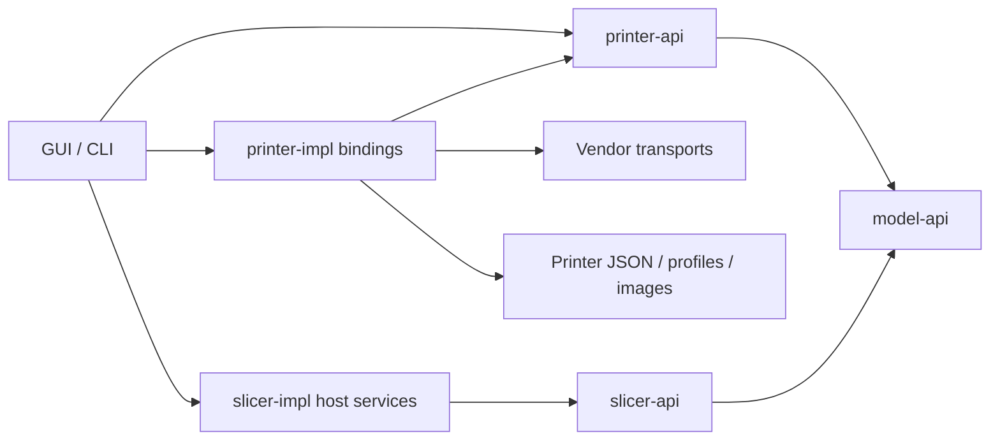

# Develop printer and slicer integrations

Start with the [driver-authoring walkthrough](https://github.com/Voxel-Brew/api-printer/blob/f789baea542ac8daedc1e9d6852a69050ada2cbc/docs/DEV_README.md).
It includes a complete Java 21 driver and Virtual UI form, Gradle setup, service
registration, installation, discovery code, CLI examples, and fixture test cases.
The HTTP protocol in the walkthrough is illustrative; adapt it to your printer's
transport and acceptance guarantees.

This page explains where that code belongs in the VoxelBrew workspace.

## Find the right module

| Location                             | Responsibility                                                                       |
| ------------------------------------ | ------------------------------------------------------------------------------------ |
| `api/printer`                        | Public driver, form, configuration, profile, registry, and storage contracts         |
| `VoxelBrew/printer` (`printer-impl`) | Built-in drivers, transports, printer JSON, profile catalog, licensed images         |
| `VoxelBrew/gui`                      | Inline setup, profile editing, background submission and monitoring                  |
| `VoxelBrew/cli`                      | The same configuration, validation, stores, and driver operations for commands       |
| `api/model`                          | Portable hardware settings, document setup, and artifacts; no printer-api dependency |
| `api/slicer` and `VoxelBrew/slicer`  | Slicer contracts and implementation; resolve hardware into jobs                      |

The workspace root is a Gradle composite, not a Git repository. Commit in the owning
checkout. Public contract changes belong in the API repository; vendor transports
belong in `printer-impl` or an external plugin.



## Add a built-in driver

1. Create a vendor package under `printer/src/main/java/dev/voxelbrew/printer`.
2. Implement `Driver` and `DriverGui` following the walkthrough. Keep input IDs in
   constants. Return a stable ID and meaningful `name()`, and provide a public
   no-argument constructor. Metadata and form methods must not open connections.
3. Add the driver class name to
   `printer/src/main/resources/META-INF/services/dev.voxelbrew.api.printer.driver.Driver`.
4. Add deterministic protocol fixtures under `printer/src/test/test/java`.

Read [MoonrakerDriver](../printer/src/main/java/dev/voxelbrew/printer/moonraker/MoonrakerDriver.java)
and [MoonrakerDriverGui](../printer/src/main/java/dev/voxelbrew/printer/moonraker/MoonrakerDriverGui.java)
for HTTP integration, or
[BambuLabDriver](../printer/src/main/java/dev/voxelbrew/printer/bambulab/BambuLabDriver.java)
for FTPS/MQTT and packaged artifacts. These are implementations, not dependencies
for third-party plugins.

Each operation owns and closes its resources. One driver can serve several saved
printers concurrently. GUI/CLI own endpoint locks, call drivers directly on workers,
and check targets through `Printer.validateArtifact()`. Submission success means
acceptance, not completion. Return uncertain failure after a lost start response;
never retry automatically. Preserve confirmed success if cleanup fails. Monitoring
failures return an actionable `ERROR` observation.

GUI and CLI load `DriverRegistry` directly with `ServiceLoader`. `printer-impl`
registers `DefaultDriverRegistry` as the public service entry point and keeps
`ServiceLoaderDriverRegistry` package-private. The host configures the plugin
directory and closes the registry after its worker operations finish.

## Understand host persistence

`Printer` stores `id`, `name`, `driverId`, `driverConfiguration`, and an embedded
`Profile` snapshot. Application component scopes construct `FilePrinterStore`
with their `UserConfiguration` and `DefaultPrinterProfileCatalog` with their
`ApplicationPaths.profiles()` directory. Consumers receive `PrinterStore` and
`PrinterProfileCatalog`; neither uses a construction factory or ServiceLoader.
Explicit `Path` constructors support isolated tests.

Printer JSON is stored under `~/.voxelbrew/printers`, with atomic writes and
restricted credential permissions. Custom profiles and copied images live under
`~/.voxelbrew/profiles`. Catalog edits do not modify saved snapshots; users select
updated profiles explicitly. Documents contain resolved hardware and target IDs,
never driver credentials.

`ProfileHardware.resolve(profile)` in `printer-impl` converts a selected profile into
the document's resolved `HardwareSettings`. This application boundary keeps
printer-api independent of changes to model-api's document snapshot types.

Slicing offers saved printers by name and standalone profiles. Profile-only jobs
expose artifact saving. Physical jobs expose submission and monitoring for the exact
saved printer. Missing printers or drivers require explicit reconfiguration.

## Develop a slicer plugin

The provider-based slicer API is a breaking replacement. Recompile plugins against the
matching API and register the provider under
`META-INF/services/dev.voxelbrew.api.slicer.SlicerProvider`. The slicer developer guide
includes a complete provider, Virtual UI settings, artifact provenance, and the host lifecycle.

The host chooses the plate and printer target, resolves hardware, and evaluates geometry.
Each provider operation receives one detached manufacturing model and collects settings
before conversion. Open **Slicers → Configure slicers**, choose a type, and give
each installation a name. **Test** displays the provider's detected version or the
reason the check failed. **Save** runs a fresh check and closes the dialog after
successfully saving the installation. Installations are stored
individually under `~/.voxelbrew/slicers/`. The **Process** tab lists verified
custom installations alongside the bundled PrusaSlicer and OrcaSlicer entries.
The bundled entries have stable IDs and read-only settings. The document remembers
the selected installation ID.

Use **Discover** beside the executable field to list candidates for the selected provider.
Built-in providers search the command path and common installation locations on the current
platform. Selecting a result fills the field so you can test or save the setup.
Use `slicer backend discover --id prusa-slicer` to list candidates from the CLI.

The CLI uses the named installation selected in the document. For documents with
only a provider ID, use `slicer backend configure` to set provider defaults. A slice command can
override input IDs with repeatable `--slicer-option key=value` values. `--slicer`
supplies the built-in executable field. Invocation values take priority over saved
inputs and dialog defaults for custom installations.

On supported hosts, the build verifies pinned upstream artifacts and embeds
their platform-specific payloads in `slicer-impl`. Builds with the bundles require
Python 3.9 or later and curl. Linux and macOS also use tar. Run a thin build with
`-PbundleSlicers=false`, or set `-PslicerPython=/path/to/python` to choose an
interpreter. Downloads are cached in `.tools/bundled-slicers/`. Each app package
contains the binaries for its own operating system. The Windows x64 package uses
the portable ZIPs, the Ubuntu 24.04 x64 package uses the AppImage contents, and
macOS uses the universal app bundles. Orca uses the pinned
release's Bambu presets to resolve the selected printer, nozzle and material.
An unavailable combination fails before slicing. Bundled payloads are unpacked
to private temporary directories during the operation and removed afterward.
The Ubuntu 24.04 bundles use the system GTK, OpenGL and WebKitGTK libraries,
including `libgtk-3-0t64`, `libglu1-mesa`, `libopengl0` and `libwebkit2gtk-4.1-0`.

Discovery lists descriptors without probing the environment. Executable and capability
checks occur during operations. Built-in providers serialize the evaluated plate to
private files with exporter implementation writers, invoke the executable, and return
a portable artifact. The host independently inspects its contents and provenance before
attaching it. Explicit output uses atomic publication. A multi-plate command evaluates
and validates every job before attaching results.

## Build and verify in the workspace

Use Java 21 and the checked-in wrapper. Launch the desktop from the workspace
root on Windows with `.\gradlew.bat :voxelbrew:gui:run`, or from the
`VoxelBrew/` application directory with `.\gradlew.bat :gui:run`. Both entry
points resolve the local BOM and API projects in a complete workspace. For
verification, run the following tasks from the workspace root.

```powershell
.\gradlew.bat :printer:check :slicer:check
.\gradlew.bat :voxelbrew:slicer-impl:test :voxelbrew:slicer-impl:integrationTest
.\gradlew.bat :voxelbrew:printer-impl:test
.\gradlew.bat :voxelbrew:gui:test :voxelbrew:cli:test
.\gradlew.bat :voxelbrew:gui:compileE2eTestJava :voxelbrew:cli:compileIntegrationTestJava
```

On Linux use `./gradlew`. For coordinated changes, compile all affected production
and test source sets through the workspace composite. Run formatting from the
owning repository. Use targeted native UI tests when host behavior changes; do not
run the full E2E suite by default.

Application CI resolves published BOM and API snapshots from the configured
repositories. Use the local workspace composite when developing coordinated API
changes. Its fixture prerequisites publish the local APIs to Maven local so the
independent provider fixture still compiles against published artifacts.

Cover rejection, uncertain submission, monitoring failure, timeout, interruption,
resource cleanup, and plugin discovery. Record physical hardware qualification
separately, including printer model, firmware, transport, and observed operations.
